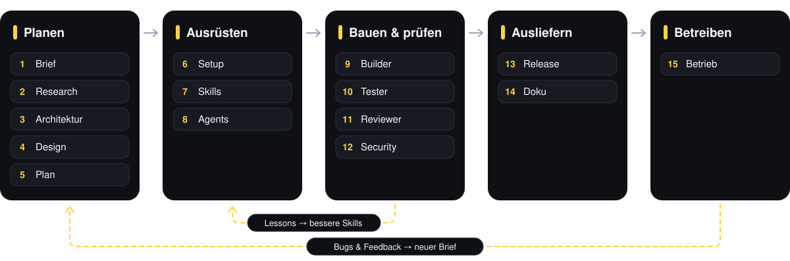

<p align="center">
  
</p>

<p align="center">
  <a href="https://github.com/atshv/banan/tags"></a>
  
  
  
</p>

<p align="center">
  <b>Du beschreibst deine Idee. banan baut sie Station für Station bis zur fertigen App.</b><br>
  Du entscheidest nur an vier Stellen. Den Rest prüft die Factory selbst.
</p>

<br>

## 🚀 Start

```bash
git clone https://github.com/atshv/banan
cd banan
./install.sh ~/Projekte/meine-app
```

Dann im Projektordner Claude Code öffnen und `/factory-start` eingeben. Du brauchst nur Git und Python 3.

## 💬 Bedienung

| Du gibst ein | Was passiert |
|:--|:--|
| `/factory-start` | Interview zu deiner Idee, daraus entsteht der Brief |
| `/factory-weiter` | Arbeitet weiter bis zur nächsten Entscheidung |
| `/factory-status` | Stand in einfacher Sprache |
| `/factory-release` | Liefert die nächste Version aus |
| `Freigabe Brief` | Deine Freigabe, auch für `Architektur`, `Design` und `Release` |

## 🏭 Die Linie

<p align="center">
  
</p>

Scheitert ein Task dreimal, kommt er zu dir.

## 🎯 Profile

Der Brief legt fest, was gebaut wird. Jedes Profil bringt eigenen Stack, eigene Pflicht-Prüfungen und eine eigene Release-Liste mit. Ein Projekt kann mehrere haben.

| 🌐 [`web-app`](profiles/web-app.md) | 📱 [`iphone-app`](profiles/iphone-app.md) | ⚙️ [`engine`](profiles/engine.md) | 🖥️ [`backend`](profiles/backend.md) |
|:--|:--|:--|:--|
| Websites und Web-Apps | Native iPhone-Apps | Kernlogik ohne Oberfläche | Server, APIs, CLI |

## 🔒 Schalter statt Vertrauen

Die wichtigsten Regeln erzwingt ein kleines Programm, nicht nur eine Anweisung. Solange es nichts blockiert, kostet es keine Tokens.

| | |
|:--|:--|
| 🌿 **Geschützter Hauptzweig**<br>Kein Produktcode direkt auf `main` | 📦 **Task-Bereich**<br>Ein Builder schreibt nur in den Ordnern seines Tasks |
| ✅ **Echte Nachweise**<br>Tests scheitern zuerst und bestehen danach, dazu Typprüfung, Lint und Build, alles aufgezeichnet | 🙋 **Deine Freigabe**<br>Die KI kann sich nicht selbst freigeben |

Dazu kommen ein gesperrter Vertrag für Schnittstellen, eine Grössengrenze pro Task und eine zweite Review bei heiklen Tasks. Details und Grenzen stehen in [`shared/schalter.md`](shared/schalter.md).

<details>
<summary><b>📁 Was im Repo liegt</b></summary>
<br>

| Ordner | Inhalt |
|:--|:--|
| [`stations/`](stations) | 15 Stationen, je eine `SKILL.md` |
| [`shared/`](shared) | Regeln für alle Stationen |
| [`memory/`](memory) | Vorlagen fürs Projekt-Gedächtnis |
| [`profiles/`](profiles) | Ein Profil pro Projekttyp |
| [`design/`](design) | Design-Regeln nach Magic UI |
| [`engine/claude-code/`](engine/claude-code) | Orchestrator, Sub-Agents, Befehle, Schalter |
| [`vendor-skills/`](vendor-skills) | Übernommene Skills mit ihren Lizenzen |

`install.sh` kann jederzeit wieder laufen und aktualisiert banan im Projekt. Dein Projekt-Gedächtnis und eigene Einstellungen bleiben erhalten.

</details>

<br>

<p align="center">
  <a href="CHANGELOG.md">Changelog</a> ·
  <a href="shared/versionierung.md">Versionen</a> ·
  vor v1.0.0 Entwicklungsstand
</p>

<p align="center">
  <sub>Skill-Muster aus <a href="https://github.com/anthropics/skills">anthropics/skills</a> · Design-Regeln aus <a href="https://github.com/magicuidesign/magicui">magicuidesign/magicui</a> · Feinschliff aus <a href="https://github.com/emilkowalski/skills">emilkowalski/skills</a></sub>
</p>
